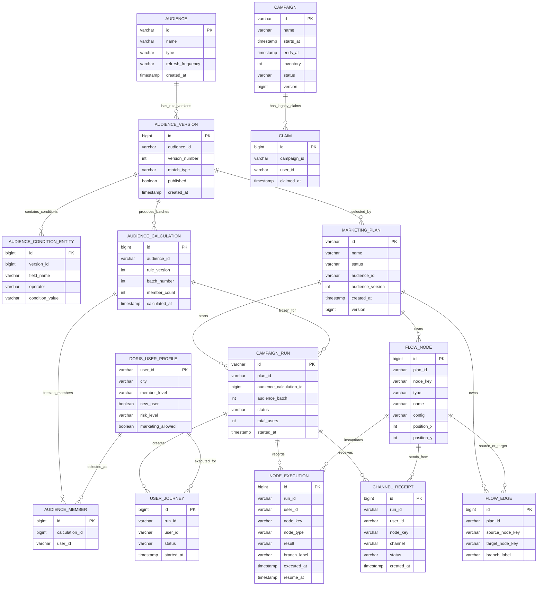

# CampaignLab V1.0 数据字典与 ER 模型

> 基线日期：2026-10-05  
> 数据库：MySQL 8.4，Schema：`campaignlab`，迁移版本：Flyway V3  
> 事实来源：`V1__initial_schema.sql`、`V2__marketing_plan_canvas.sql`、`V3__execution_trace.sql` 与当前 Java 实体/Service。本文只描述已经存在的结构；未来设计会明确标注。

## 1. 怎样理解整套数据

CampaignLab 的主链路分成三层：

1. **CDP 客群层**：用户画像 → 客群定义 → 不可变规则版本 → 某次计算批次 → 该批次成员。
2. **MDP 计划层**：营销计划 → 画布节点 + 节点连线；计划固定引用一个已发布客群规则版本。
3. **执行证据层**：一次计划运行固定引用一个客群计算批次 → 为每个成员创建用户旅程 → 保存逐节点轨迹与渠道回执。

`campaign`、`claim` 是早期“权益领取”技术切片的遗留表，不属于当前 MDP 主链路。它们暂时保留用于已有接口和回归测试，后续删除必须单独迁移，不能直接把它们解释成营销计划。

## 2. ER 图

图中的连线表示**当前应用逻辑关系**。当前迁移脚本没有声明 `FOREIGN KEY`，因此这些关系还不是由 MySQL 外键强制保证；数据库真正强制的只有主键、唯一约束、非空约束和少量索引。

说明：`AUDIENCE_VERSION` 到 `AUDIENCE_CALCULATION`、`MARKETING_PLAN` 的关联实际是组合键 `audience_id + version_number`；`FLOW_EDGE` 到 `FLOW_NODE` 的关联实际是组合键 `plan_id + node_key`；执行轨迹同理使用业务键定位节点。Mermaid 只能简化展示，因此字段级关系以第 7 节为准。

## 3. CDP 客群域

### 3.1 `doris_user_profile`：合成用户画像

这张 MySQL 表模拟真实架构中的 Doris 用户画像宽表，是标签圈选和执行标签判断的数据源，不代表系统已连接真实 Doris。

| 字段 | 类型/约束 | 业务含义 |
|---|---|---|
| `user_id` | `VARCHAR(64)`，PK，非空 | 用户唯一标识，也是客群成员和执行用户的业务关联键。 |
| `city` | `VARCHAR(128)`，可空 | 城市标签，如 `Shanghai`。 |
| `member_level` | `VARCHAR(64)`，可空 | 会员等级标签，如 `VIP`。 |
| `new_user` | `BOOLEAN`，非空 | 是否新用户。 |
| `risk_level` | `VARCHAR(64)`，可空 | 风险等级标签。 |
| `marketing_allowed` | `BOOLEAN`，非空 | 是否允许营销，用于圈选或标签判断。 |

### 3.2 `audience`：客群主表

一行代表一个客群身份；规则变化不会新建客群，而是在 `audience_version` 中增加版本。

| 字段 | 类型/约束 | 业务含义 |
|---|---|---|
| `id` | `VARCHAR(64)`，PK，非空 | 客群 ID，UUID 字符串。 |
| `name` | `VARCHAR(255)`，非空 | 客群名称。 |
| `type` | `VARCHAR(32)`，非空 | `STATIC` 静态客群或 `DYNAMIC` 动态客群。 |
| `refresh_frequency` | `VARCHAR(32)`，非空 | `NONE` 不刷新或 `DAILY` 每日刷新；当前动态刷新由 API 模拟触发，尚无定时任务。 |
| `created_at` | `TIMESTAMP(6)`，非空 | 客群创建时间，保留微秒精度。 |

### 3.3 `audience_version`：客群规则版本

V1/V2 表示“条件配置发生变化”，不是成员数据刷新次数。发布后，营销计划才能选择该版本。

| 字段 | 类型/约束 | 业务含义 |
|---|---|---|
| `id` | `BIGINT`，PK，自增 | 规则版本内部主键。 |
| `audience_id` | `VARCHAR(64)`，非空 | 所属客群 ID，逻辑关联 `audience.id`。 |
| `version_number` | `INT`，非空 | 客群内递增的版本号，如 1、2。 |
| `match_type` | `VARCHAR(32)`，非空 | `ALL` 表示全部条件 AND；`ANY` 表示任一条件 OR。 |
| `published` | `BOOLEAN`，非空，默认 `FALSE` | 是否已发布；当前计划只能引用已发布版本。 |
| `created_at` | `TIMESTAMP(6)`，非空 | 该规则版本创建时间。 |

唯一约束：`(audience_id, version_number)`，保证同一客群不能出现两个相同 V 版本。

### 3.4 `audience_condition_entity`：版本标签条件

每一行是一条标签判断；多条条件怎样组合由版本表的 `match_type` 决定。

| 字段 | 类型/约束 | 业务含义 |
|---|---|---|
| `id` | `BIGINT`，PK，自增 | 条件内部主键。 |
| `version_id` | `BIGINT`，非空，有普通索引 | 所属规则版本，逻辑关联 `audience_version.id`。 |
| `field_name` | `VARCHAR(64)`，非空 | 标签字段；当前 Service 允许 `city`、`memberLevel`、`newUser`、`riskLevel`、`marketingAllowed`。 |
| `operator` | `VARCHAR(32)`，非空 | 当前支持 `EQUALS`、`NOT_EQUALS`。 |
| `condition_value` | `VARCHAR(255)`，非空 | 用字符串保存的比较值，由字段类型负责解释。 |

### 3.5 `audience_calculation`：客群计算批次

R1/R2 表示“同一规则在不同时间计算出的成员集合”。执行计划时会冻结一个具体批次，避免执行途中成员漂移。

| 字段 | 类型/约束 | 业务含义 |
|---|---|---|
| `id` | `BIGINT`，PK，自增 | 计算批次内部主键。 |
| `audience_id` | `VARCHAR(64)`，非空 | 被计算的客群 ID。 |
| `rule_version` | `INT`，非空 | 本批次使用的规则版本号。 |
| `batch_number` | `INT`，非空 | 该规则版本下的计算序号，如 R1、R2 中的数字。 |
| `member_count` | `INT`，非空 | 计算完成时的成员数冗余快照，用于快速展示和核对。 |
| `calculated_at` | `TIMESTAMP(6)`，非空 | 计算完成时间。 |

唯一约束：`(audience_id, rule_version, batch_number)`。

### 3.6 `audience_member`：批次成员快照

一行代表某用户属于某个计算批次。它保存结果，不会因为画像后来改变而被原地改写。

| 字段 | 类型/约束 | 业务含义 |
|---|---|---|
| `id` | `BIGINT`，PK，自增 | 成员记录内部主键。 |
| `calculation_id` | `BIGINT`，非空 | 逻辑关联 `audience_calculation.id`。 |
| `user_id` | `VARCHAR(64)`，非空 | 逻辑关联 `doris_user_profile.user_id`。 |

唯一约束：`(calculation_id, user_id)`，防止同一用户在同一批次中重复出现。

## 4. MDP 营销计划域

### 4.1 `marketing_plan`：营销计划主表

计划是画布和执行的聚合根。它在创建时固定选择 `audience_id + audience_version`，执行时再取该版本最新计算批次。

| 字段 | 类型/约束 | 业务含义 |
|---|---|---|
| `id` | `VARCHAR(64)`，PK，非空 | 计划 UUID。 |
| `name` | `VARCHAR(255)`，非空 | 计划名称。 |
| `status` | `VARCHAR(32)`，非空 | `DRAFT` 草稿或 `PUBLISHED` 已发布。只有已发布计划可执行。 |
| `audience_id` | `VARCHAR(64)`，非空 | 目标客群 ID。 |
| `audience_version` | `INT`，非空 | 目标客群规则版本号；与 `audience_id` 共同定位版本。 |
| `created_at` | `TIMESTAMP(6)`，非空 | 计划创建时间。 |
| `version` | `BIGINT`，非空 | JPA 乐观锁版本，防止并发更新互相覆盖。 |

### 4.2 `flow_node`：画布节点

一行代表计划画布中的一个节点。发布时由 Service 校验图结构和不同节点的配置。

| 字段 | 类型/约束 | 业务含义 |
|---|---|---|
| `id` | `BIGINT`，PK，自增 | 数据库内部主键。 |
| `plan_id` | `VARCHAR(64)`，非空 | 所属计划，逻辑关联 `marketing_plan.id`。 |
| `node_key` | `VARCHAR(64)`，非空 | 节点在计划内的稳定业务键，供连线和执行轨迹引用。 |
| `type` | `VARCHAR(32)`，非空 | `START`、`MARKETING`、`DECISION`、`PLACEHOLDER`、`DELAY`、`END`。 |
| `name` | `VARCHAR(255)`，可空 | 页面展示名称。 |
| `config` | `VARCHAR(2000)`，可空 | 按节点类型解释的配置，详见下表。 |
| `position_x` | `INT`，非空 | 画布横坐标。当前受控竖向编辑器会保存，但布局主要由前端递归结构决定。 |
| `position_y` | `INT`，非空 | 画布纵坐标。 |

唯一约束：`(plan_id, node_key)`。

`config` 当前编码：

| 节点类型 | 示例 | 含义 |
|---|---|---|
| `MARKETING` | `CALL` / `SMS` / `COUPON` | 电话、短信、发券。 |
| `DECISION` | `AB:30:70` | A/B 比例，二者必须为非负整数且合计 100。 |
| `DECISION` | `LABEL:city=Shanghai` | 标签判断，结果路径为 `YES` / `NO`。 |
| `DECISION` | `RECEIPT` | 上一个营销节点的回执判断，路径为 `SUCCESS` / `FAILURE`。 |
| `DELAY` | `5` | 延迟分钟数，必须是 1 到 525600 的正整数。 |
| 其他 | 空 | 当前不需要配置。 |

### 4.3 `flow_edge`：画布连线

连线定义节点的执行顺序和判断分支。普通节点只能有一条出边；判断节点按照 `branch_label` 选择路径。

| 字段 | 类型/约束 | 业务含义 |
|---|---|---|
| `id` | `BIGINT`，PK，自增 | 连线内部主键。 |
| `plan_id` | `VARCHAR(64)`，非空 | 所属计划。 |
| `source_node_key` | `VARCHAR(64)`，非空 | 起点，逻辑关联同一计划的 `flow_node.node_key`。 |
| `target_node_key` | `VARCHAR(64)`，非空 | 终点，逻辑关联同一计划的 `flow_node.node_key`。 |
| `branch_label` | `VARCHAR(32)`，可空 | 普通边为空；A/B 为 `A/B`，标签为 `YES/NO`，回执为 `SUCCESS/FAILURE`。 |

## 5. 执行与证据域

### 5.1 `campaign_run`：计划执行批次

一次点击“启动执行”创建一行。它同时冻结计划和客群计算结果之间的关系。

| 字段 | 类型/约束 | 业务含义 |
|---|---|---|
| `id` | `VARCHAR(64)`，PK，非空 | 执行批次 UUID。 |
| `plan_id` | `VARCHAR(64)`，非空 | 被执行的计划 ID。 |
| `audience_calculation_id` | `BIGINT`，非空 | 本次固定使用的客群计算批次主键。 |
| `audience_batch` | `INT`，非空 | 批次编号冗余快照，便于 API/UI 直接展示 R 编号。 |
| `status` | `VARCHAR(32)`，非空 | `RUNNING`、`WAITING`、`SUCCEEDED`、`FAILED`；当前实现会产生前三种，失败状态尚无完整落库路径。 |
| `total_users` | `INT`，非空 | 启动时冻结的成员总数。 |
| `started_at` | `TIMESTAMP(6)`，非空 | 执行开始时间。 |

### 5.2 `user_journey`：逐用户流程实例

同一次运行中，每个客群成员有且只有一条用户旅程。

| 字段 | 类型/约束 | 业务含义 |
|---|---|---|
| `id` | `BIGINT`，PK，自增 | 用户旅程内部主键。 |
| `run_id` | `VARCHAR(64)`，非空 | 所属执行批次。 |
| `user_id` | `VARCHAR(64)`，非空 | 被执行的用户。 |
| `status` | `VARCHAR(32)`，非空 | 当前用户的 `RUNNING`、`WAITING`、`SUCCEEDED` 或 `FAILED` 状态。 |
| `started_at` | `TIMESTAMP(6)`，非空 | 该用户旅程开始时间。 |

唯一约束：`(run_id, user_id)`。

### 5.3 `node_execution`：逐节点执行轨迹

这是 QualityPilot 验证执行是否正确的核心证据表。每经过一个节点就追加一条事件，查询时按自增 `id` 排序还原路径。

| 字段 | 类型/约束 | 业务含义 |
|---|---|---|
| `id` | `BIGINT`，PK，自增 | 轨迹顺序键；当前也承担事件先后顺序。 |
| `run_id` | `VARCHAR(64)`，非空 | 所属执行批次。 |
| `user_id` | `VARCHAR(64)`，非空 | 所属用户。 |
| `node_key` | `VARCHAR(64)`，非空 | 实际经过的画布节点业务键。 |
| `node_type` | `VARCHAR(32)`，非空 | 执行当时记录的节点类型快照。 |
| `result` | `VARCHAR(255)`，可空 | 如 `PASSED`、`BRANCH_A`、`SUCCESS`、`FAILURE`、`WAITING`、`SUCCEEDED`。 |
| `branch_label` | `VARCHAR(32)`，可空 | 判断节点实际选择的路径；非判断节点为空。 |
| `executed_at` | `TIMESTAMP(6)`，非空 | 节点执行时间。 |
| `resume_at` | `TIMESTAMP(6)`，可空 | 延迟节点计划恢复时间；当前只记录，不会被调度器自动恢复。 |

### 5.4 `channel_receipt`：模拟渠道回执

营销节点执行时写入一条确定性模拟回执。它模拟电话、短信、发券渠道，不代表已经接入真实外部渠道。

| 字段 | 类型/约束 | 业务含义 |
|---|---|---|
| `id` | `BIGINT`，PK，自增 | 回执内部主键。 |
| `run_id` | `VARCHAR(64)`，非空 | 所属执行批次。 |
| `user_id` | `VARCHAR(64)`，非空 | 被触达用户。 |
| `node_key` | `VARCHAR(64)`，非空 | 产生回执的营销节点。 |
| `channel` | `VARCHAR(32)`，非空 | 当前值来自营销节点配置：`CALL`、`SMS`、`COUPON`。 |
| `status` | `VARCHAR(32)`，非空 | 当前模拟结果为 `SUCCESS` 或 `FAILURE`。 |
| `created_at` | `TIMESTAMP(6)`，非空 | 回执生成时间。 |

## 6. 遗留技术切片与基础设施表

### 6.1 `campaign`：遗留权益活动

这不是当前 `marketing_plan`。它用于最早的“同一用户不可重复领取、库存扣减”并发/事务演示。

| 字段 | 类型/约束 | 业务含义 |
|---|---|---|
| `id` | `VARCHAR(64)`，PK，非空 | 遗留活动 ID。 |
| `name` | `VARCHAR(255)`，非空 | 活动名称。 |
| `starts_at` | `TIMESTAMP(6)`，可空 | 开始时间。 |
| `ends_at` | `TIMESTAMP(6)`，可空 | 结束时间。 |
| `inventory` | `INT`，非空 | 当前剩余库存。成功领取减 1；重复领取被拒绝时不变。 |
| `status` | `VARCHAR(32)`，非空 | `DRAFT`、`ACTIVE`、`ENDED`。 |
| `version` | `BIGINT`，非空 | JPA 乐观锁版本，保护并发库存更新。 |

### 6.2 `claim`：遗留权益领取记录

| 字段 | 类型/约束 | 业务含义 |
|---|---|---|
| `id` | `BIGINT`，PK，自增 | 领取记录 ID。 |
| `campaign_id` | `VARCHAR(64)`，非空 | 逻辑关联遗留 `campaign.id`。 |
| `user_id` | `VARCHAR(64)`，非空 | 领取用户。 |
| `claimed_at` | `TIMESTAMP(6)`，非空 | 领取成功时间。 |

唯一约束：`(campaign_id, user_id)`，从数据库层阻止同一用户重复领取同一活动。

### 6.3 `flyway_schema_history`：数据库迁移历史

这是 Flyway 自动维护的基础设施表，不由业务代码读写。它记录 V1/V2/V3 是否成功应用，使不同环境能够按相同顺序升级 Schema。

| 字段 | 典型类型/约束 | 含义 |
|---|---|---|
| `installed_rank` | `INT`，PK | 迁移实际安装顺序。 |
| `version` | `VARCHAR(50)`，可空 | 版本号，如 `1`、`2`、`3`。 |
| `description` | `VARCHAR(200)`，非空 | 迁移描述。 |
| `type` | `VARCHAR(20)`，非空 | 迁移类型，当前主要为 `SQL`。 |
| `script` | `VARCHAR(1000)`，非空 | 脚本文件名。 |
| `checksum` | `INT`，可空 | 脚本校验值，用于发现已执行迁移被篡改。 |
| `installed_by` | `VARCHAR(100)`，非空 | 执行迁移的数据库用户。 |
| `installed_on` | `TIMESTAMP`，非空，默认当前时间 | 安装时间。 |
| `execution_time` | `INT`，非空 | 执行耗时，毫秒。 |
| `success` | `BOOLEAN`，非空 | 是否执行成功。 |

注意：Flyway 版本升级可能微调这张表的物理长度或索引，业务知识包不应依赖它的字段作为业务接口。

## 7. 精确关系与约束

| 父对象 | 子对象 | 关联字段 | 基数 | MySQL 外键 | 当前保护方式 |
|---|---|---|---|---|---|
| `audience` | `audience_version` | `audience.id = audience_version.audience_id` | 1:N | 无 | Service 创建顺序 + 版本唯一约束 |
| `audience_version` | `audience_condition_entity` | `audience_version.id = version_id` | 1:N | 无 | Service 同事务保存 |
| `audience_version` | `audience_calculation` | `(audience_id, version_number) = (audience_id, rule_version)` | 1:N | 无 | 查询规则 + 批次唯一约束 |
| `audience_calculation` | `audience_member` | `id = calculation_id` | 1:N | 无 | 同事务保存 + 成员唯一约束 |
| `doris_user_profile` | `audience_member` | `user_id = user_id` | 1:N | 无 | 圈选结果来自画像查询 |
| `audience_version` | `marketing_plan` | `(audience_id, version_number) = (audience_id, audience_version)` | 1:N | 无 | 发布计划时校验版本存在且已发布 |
| `marketing_plan` | `flow_node` | `id = plan_id` | 1:N | 无 | 同事务保存 + 节点业务键唯一约束 |
| `marketing_plan` | `flow_edge` | `id = plan_id` | 1:N | 无 | 同事务保存 + 发布时图校验 |
| `flow_node` | `flow_edge` | `(plan_id,node_key)` 对应 source/target | N:N 图关系 | 无 | 创建时校验端点存在，发布时校验图 |
| `marketing_plan` | `campaign_run` | `id = plan_id` | 1:N | 无 | 启动时校验计划存在且已发布 |
| `audience_calculation` | `campaign_run` | `id = audience_calculation_id` | 1:N | 无 | 启动时查询最新批次 |
| `campaign_run` | `user_journey` | `id = run_id` | 1:N | 无 | 执行事务 + `(run_id,user_id)` 唯一约束 |
| `campaign_run` | `node_execution` | `id = run_id` | 1:N | 无 | 执行 Service 追加轨迹 |
| `campaign_run` | `channel_receipt` | `id = run_id` | 1:N | 无 | 营销节点执行时追加回执 |
| `flow_node` | 轨迹/回执 | `(plan_id,node_key)` 间接对应 `node_key` | 1:N | 无 | 运行按计划加载节点后写入 |
| `campaign` | `claim` | `campaign.id = claim.campaign_id` | 1:N | 无 | Service + `(campaign_id,user_id)` 唯一约束 |

### 为什么“没有外键”值得测试

当前设计有利于快速原型和批量写入，但存在可验证风险：直接操作数据库或 Service 出错时，可能产生孤儿条件、孤儿成员、无主节点、指向不存在节点的边、无对应运行的轨迹。QualityPilot 后续可据此生成数据一致性用例，而不应仅验证 HTTP 返回 200。

## 8. QualityPilot 后续怎样展示和使用

当前可直接把本文作为项目知识包中的“数据模型”文档，由 QualityPilot 的文档阅读区渲染 Markdown 与 Mermaid。后续接入分两步，以下均为**计划，不是已实现能力**：

1. **展示层**：在项目知识页新增“数据模型”页签，显示领域分组、字段字典和 Mermaid ER 图。
2. **分析层**：把表、字段、关系、约束、枚举、实现状态解析为结构化知识；风险分析引用具体关系，例如“`campaign_run.audience_calculation_id` 无外键，需验证无效批次不能启动”。

建议 QualityPilot 为每条结构化关系保留：`sourceTable`、`sourceFields`、`targetTable`、`targetFields`、`cardinality`、`enforcedByDatabase`、`evidence`。其中 `evidence` 必须指向迁移脚本或实现代码，避免模型把推测当成事实。

## 9. 可直接生成的测试关注点

- 唯一性：同一客群 V 版本、同一计算 R 批次、同批次重复成员、同运行重复用户是否被拒绝。
- 引用完整性：不存在或未发布的客群版本不能发布计划；不存在的计划不能启动运行。
- 快照一致性：`member_count` 应等于该 `calculation_id` 下成员行数；`total_users` 应等于运行冻结的成员数。
- 图完整性：边端点必须存在、所有节点从 START 可达、无环、所有路径最终到 END。
- 轨迹一致性：轨迹节点必须属于本次计划；判断的 `branch_label` 必须与配置类型匹配。
- 状态一致性：存在等待轨迹时运行/用户应为 `WAITING`；到达 END 后应为 `SUCCEEDED`。
- 回执一致性：回执只应由 `MARKETING` 节点产生，渠道值应与节点配置一致。
- 遗留边界：`campaign/claim` 的 ID 不得被误当作 `marketing_plan/campaign_run` 使用。

